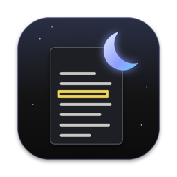

<p align="center"></p>

# nox

A keyboard-driven PDF viewer for macOS.

nox inherits the idea behind [Sioyek](https://sioyek.info): a PDF viewer for reading research papers and
textbooks, driven from the keyboard. It focuses more on being a **native Mac app** (built on Apple's PDFKit, the engine inside
Preview), on keeping **highlights and notes inside the PDF itself**, and on the **LaTeX + Neovim** writing loop.
It shares no code with Sioyek; the two can share the same notes scripts.

## Features

- **Vim-style keys** for everything: scrolling, pages, marks, search, zoom.
- **Dark mode for pages**: white paper becomes near-black, black ink becomes light; `,c` (or F8) toggles.
  Colors can be changed in `~/.config/nox/theme.json` (see [Colors](#colors)).
- **Highlights and notes saved in the PDF** as standard annotations, so Preview, Acrobat, Zotero and Skim see them too.
  Five highlight colors (`ca`–`ce`), notes on highlights (`a`), sticky notes, a note on the whole PDF (`A`), and a list
  of all of them (`gn`). The note editor opens next to the text, never on top of it.
- **Select text without the mouse** (`v`): every visible line gets a label; type one, then the label of the word to
  start at, then extend with Vim motions (`h j k l`, `w b e`, `0 $`, `f F t T ; ,`, `o`). `V` selects whole lines.
  Works in two-column papers too, including scans whose text runs across the columns line by line: nox reads
  the left column, then the right. If a selection still crosses the columns (or splits a page that has none), `,2`
  switches column handling between auto, on and off.
- **Presentation mode** (`p`): full-screen slides, presenter view (current and next slide, timer, clock) on the laptop
  when a second display is connected; `x` swaps the two screens; works with presentation clickers.
- **Reference preview**: hover a citation or an internal link (or press `F` and pick one) to see the reference, figure
  or equation it points to, without leaving your place; `↩` goes there. Works for linked LaTeX PDFs and for journal
  PDFs without links: citations like `[12]`, `(Powell, 2011)` or `Kahneman and Lovallo (1993)` are looked up in the
  reference list.
- **Table of contents** (`t`), **link hints** (`f`) and **page thumbnails** (`T`).
- **SyncTeX**: `nox main.pdf --forward LINE main.tex` shows where a source line ended up; Shift-click jumps back to the
  source in Neovim (via VimTeX).
- **Tabs**: PDFs open as tabs of one window (`gt` / `gT` / `3gt`, Ctrl-Tab); drag a tab out for its own window.
- **Vim marks**: `ma` / `'a` per PDF and kept across sessions, `mA` / `'A` across files, `''` back to before the last jump.
- **Auto-reload** when the file changes (LaTeX recompiles), keeping your place. Each PDF reopens where you left it.
- `?` shows every key; after a prefix key (`c`, `g`, `,` …) the status bar lists what can follow.

## Requirements

- macOS 13 or later, Apple silicon or Intel
- To build from source: Swift 5.9+ (Xcode or the Command Line Tools: `xcode-select --install`)
- Optional: [`qpdf`](https://qpdf.sourceforge.io) (`brew install qpdf`) — nox uses it to tidy the files it saves
- Optional: Neovim + VimTeX for SyncTeX, and a notes script for `,q` / `,n` (see below)

## Install

With [Homebrew](https://brew.sh) (this repository is its own tap):

```sh
brew tap julianjica/nox https://github.com/julianjica/nox
brew install --cask --no-quarantine nox
```

This installs `nox.app` and the `nox` command, from the latest
[release](https://github.com/julianjica/nox/releases). nox is not notarized by Apple (it is signed ad hoc), hence
`--no-quarantine`; without it macOS refuses to open it the first time. If you download `nox.zip` from a release
yourself, run `xattr -dr com.apple.quarantine nox.app` once, or right-click the app → *Open*.
Upgrade with `brew upgrade --cask --greedy nox`.

From source:

```sh
git clone https://github.com/julianjica/nox.git ~/nox
sh ~/nox/scripts/build.sh
```

This builds `build/nox.app` and installs a `nox` command in `~/.local/bin` (make sure it is on your `PATH`).
nox registers as an *alternate* PDF app; it never makes itself the default. To make it the default, choose
*Get Info → Open with → nox → Change All…* on any PDF.

## Command line

```sh
nox paper.pdf                         # open (or focus, if already open)
nox paper.pdf --page 12               # open at page 12
nox main.pdf --forward 120 main.tex   # SyncTeX: show where line 120 of main.tex ended up
nox --export paper.pdf [--write]      # highlights and notes as Markdown (--write: into paper.notes.md)
nox --help                            # all options and keys
nox --self-test                       # check that this build works
```

## Keys

```
Move
  j / k                  scroll down / up (counts work: 5j)
  Ctrl-d / Ctrl-u        half a screen down / up
  Space, Ctrl-f / Ctrl-b a screen down / up
  J / K                  next / previous page
  gg / G / 12G           first page / last page / page 12
  :                      go to a page (type its number)
  Ctrl-o / Ctrl-i        back / forward after following a link
  m{a-z} / '{a-z}        set a mark in this PDF / jump to it (kept across sessions; ` works like ')
  m{A-Z} / '{A-Z}        global mark: 'A opens that PDF at that place from any PDF
  ''                     back to where you were before the last jump (again: forth)
  t                      table of contents (j/k, ↩ go)
  f                      label the links on screen; type one to follow it (Ctrl-o back)
  F                      label citations / links on screen; type one to preview what it cites (↩ go there)
  hover                  a citation or link: preview of the reference, figure or equation it points to

Search
  /                      search
  n / N                  next / previous match
  Esc                    clear search highlights

Select text without the mouse
  v                      label the visible lines; pick one, then pick the word to start at (or start at the search match)
  V                      label the visible lines; pick one to select whole lines
  w / b / e              next word / previous word / end of word
  h j k l                character left / line down / line up / character right
  f{c} / F{c}            to the next / previous c, past the line too (t{c} / T{c}: just before it)
  ; / ,                  repeat the last f F t T / the same backwards
  0 / $                  start / end of the line
  o                      move the other end of the selection
  then                   ca–ce highlight · a note · y copy · ,q quote · Esc cancel

Highlights and notes (saved in the PDF)
  c{a-e}                 highlight (color) the selection: a yellow, b green, c cyan, d pink, e orange
  a                      note on the selection, or a sticky note where you last clicked
  A                      note on the whole PDF (first in gn and the export; empty deletes it)
  e                      edit the note you last clicked
  dh                     delete the highlight / note you last clicked
  gn                     list all highlights and notes (↩ go, e edit, d delete)
  u / Ctrl-r             undo / redo the last highlight or note change
  ,e                     export highlights and notes into <file>.notes.md
  click / right-click    a highlight: its note and actions / menu

View
  + / - / w              zoom in / out / fit the page width to the window
  W                      fit the text width to the window (margins cut; stays fitted when the window resizes)
  ,c or F8               dark mode on / off
  ,f                     full screen
  ,2                     visual mode and two columns: auto / on / off (if a selection runs across the columns)
  s                      two-page spread on / off
  T                      page thumbnails on / off (click one to go there)
  y or Cmd-C             copy the selection
  Cmd-P                  print (original colors, with highlights and notes)

Presentation
  p                      present from this page: full screen; presenter view on a second display
  → Space j / ← ⌫ k      next / previous slide (Shift-Space, Shift-⌫ too; clickers work); click / right-click too
  b or .                 blank the screen
  F8 or ,c               dark mode on / off for the slides
  12 ↩                   go to slide 12
  r / t                  restart / pause the timer
  x                      swap slides and presenter view (switch screens; on one display, show the presenter view)
  Esc or q               stop presenting (back to the slide you were on)

LaTeX and the notes file
  Shift-click            jump to the LaTeX source in Neovim (SyncTeX)
  ,q                     quote the selection into <file>.notes.md
  ,n                     open <file>.notes.md in Neovim

Files and tabs
  r / o / q              reload / open another PDF (in a new tab) / close this tab
  gt / gT / 3gt          next tab / previous tab / tab 3 (Ctrl-Tab works too)
  ?                      this list
```

## How notes are stored

- A note on a highlight is the highlight's comment; a sticky note is a PDF "text" annotation.
- The note on the whole PDF (`A`) is a text annotation in the top-left corner of the first page, marked by its
  subject `nox: note on the whole PDF`, so other PDF apps show it as an ordinary note.
- When saving, nox rebuilds the file from the copy on disk and replaces annotations only on the pages you changed,
  so the recolored display never reaches the file. The result is cleaned with `qpdf` when available and replaces
  the original only once fully written. If the file changed on disk in the meantime, nox refuses to save and asks
  you to reload.

## Exporting highlights and notes

`,e` (or `nox --export paper.pdf --write`) collects every highlight and note in the PDF, in reading order, into
`paper.notes.md` next to it: each highlight as a quote with a link to its page, followed by its note. The export
lives between two marker comments and is replaced on every export; anything you write elsewhere in the file is kept.
Without `--write`, the Markdown is printed instead.

Every change to highlights and notes can be undone with `u` and redone with `Ctrl-r`; each step is saved to the file
immediately.

## Colors

Dark mode and the interface use nox's own palette. To change it, create `~/.config/nox/theme.json` with any of these
keys (hex colors); missing keys keep their defaults:

```json
{
  "background": "#141414",
  "darker": "#0B0B0B",
  "selection": "#3A3A3A",
  "comment": "#8C8C8C",
  "foreground": "#E6E4DF",
  "accent": "#8C9EFF",
  "green": "#7CE38B",
  "red": "#FF6B6B",
  "highlight_a": "#FFE45C",
  "highlight_b": "#7CE38B",
  "highlight_c": "#6CD4FF",
  "highlight_d": "#FF7AB6",
  "highlight_e": "#FFAE57"
}
```

`background` is the page paper and `foreground` the ink in dark mode; `highlight_a` … `highlight_e` are the colors of
`ca` … `ce`. Restart nox after editing.

## Using it from VimTeX

In your Neovim config:

```lua
vim.g.vimtex_view_method = "general"
vim.g.vimtex_view_general_viewer = vim.fn.expand("~/.local/bin/nox")
vim.g.vimtex_view_general_options = "@pdf --forward @line @tex"
```

Shift-click in nox runs `nvim --headless -c "VimtexInverseSearch …"`, which jumps the running Neovim to the source line.

## Notes file bridge (`,q` / `,n`)

`,q` sends the selected text and `,n` opens a `<file>.notes.md` next to the PDF, through the script
`~/.config/sioyek/scripts/pdfnotes.sh` (shared with Sioyek). The script is not part of this repository; without it,
these two keys do nothing. Notes saved *inside* the PDF (`a`, `c{a-e}`) need no script.

## Development

- `Sources/nox/` — `DocumentController.swift` (window, keys, highlights, notes, saving, reload, selection, previews),
  `References.swift` (finding citations and what they point to), `Markdown.swift` (notes), `Presentation.swift`,
  `NoteEditor.swift`, `NotesList.swift`, `Picker.swift`, `Overlay.swift` (live highlight drawing), `NoxPage.swift`
  (dark-mode page drawing), `Keymap.swift` (the key list), `Export.swift`, `External.swift` (SyncTeX, notes script),
  `SelfTest.swift`, `AppDelegate.swift`, `main.swift`
- `scripts/build.sh` — build and install (`UNIVERSAL=1` for Apple silicon + Intel, `NO_INSTALL=1` to only build);
  `scripts/make-icon.swift` — draws the app icon
- Tests: `nox --self-test` checks Markdown, the key list, labels, notes saved in the PDF and the reference finder
  (on PDFs it generates). It needs no test framework, so it runs with just the Command Line Tools.
  GitHub Actions runs it on every push (`.github/workflows/ci.yml`).
- Releases: push a tag such as `v0.2.0`; `.github/workflows/release.yml` builds a universal `nox.app`, runs the
  self-test and publishes `nox.zip` as a GitHub release, which the Homebrew cask (`Casks/nox.rb`) installs.
- Testing without the mouse: `nox file.pdf --keys "12G"`, `--search TEXT`, `--note TEXT`, `--pdf-note TEXT`,
  `--type TEXT` / `--close-note done|discard` (an open note), `--state out.json` (a JSON snapshot of the window),
  `--snapshot out.png` (a picture of the window and any popover)
